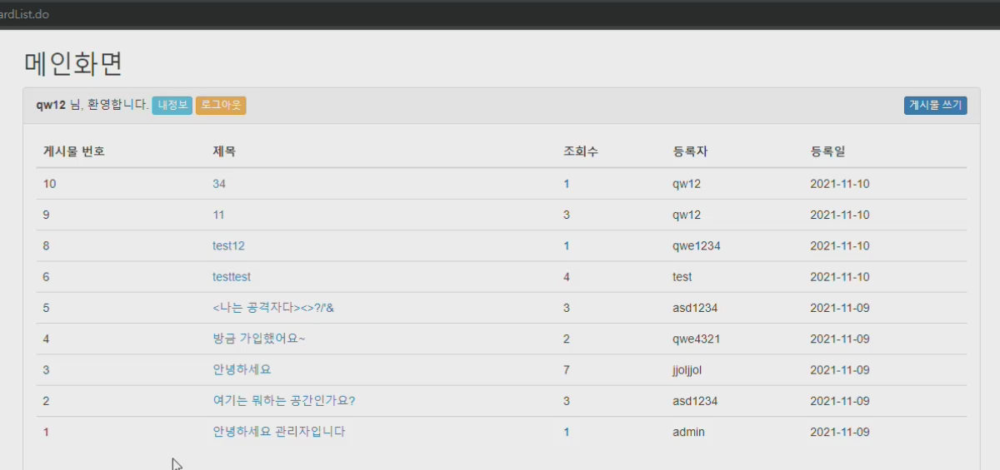
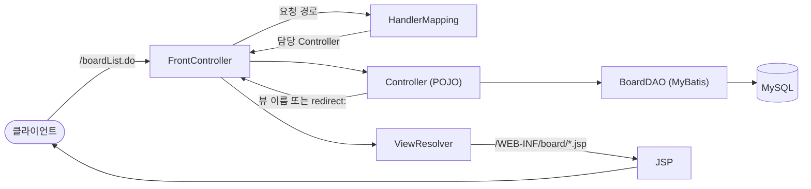
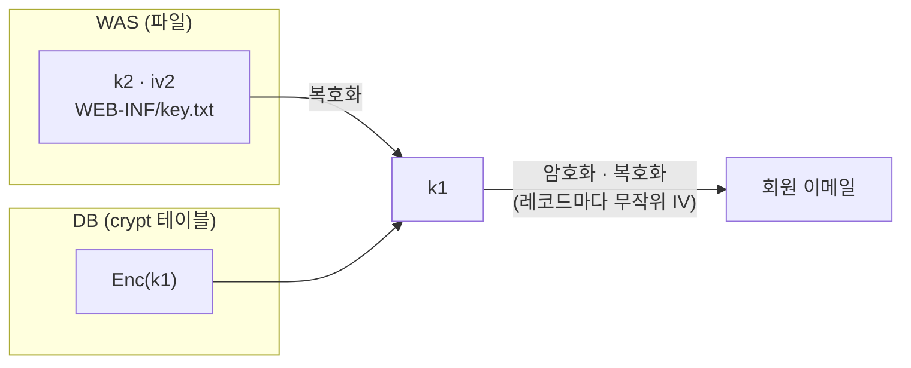

# 레트로 게시판

Spring 없이 Servlet·JSP로 **Front Controller 구조를 직접 구현**하고, 전공에서 배운 **보안 기법을 서비스 코드에 적용**한 게시판입니다.

수원대학교 정보보호학과 2021년 졸업작품이며 기획부터 배포까지 혼자 진행했습니다.

| 구분 | 내용 |
|---|---|
| 기간 | 2021.09 ~ 2021.11 |
| 인원 | 1명 (기획 · 구현 · 배포) |
| 배포 | 카페24 호스팅 (Tomcat 8.0 · MariaDB 10.1) |



> 저장소에는 DB 접속 정보와 암호화 키를 넣지 않았습니다. `.example` 파일을 복사해 사용합니다. ([실행 방법](#실행-방법))

## 목차

- [만든 이유](#만든-이유)
- [주요 기능](#주요-기능)
- [구조](#구조)
- [보안 설계](#보안-설계)
- [한계](#한계)
- [기술 스택](#기술-스택)
- [실행 방법](#실행-방법)

## 만든 이유

- Spring이 대신 해 주는 일을 직접 만들어 보며 MVC Model 2의 요청 흐름을 이해한다.
- 해시, 대칭키 암호화, 키 관리, 세션 권한 관리를 이론이 아닌 동작하는 코드로 구현한다.

## 주요 기능

| 구분 | 기능 |
|---|---|
| 회원 | 회원가입(Ajax 아이디 중복 체크), 로그인 · 로그아웃, 내 정보 조회 |
| 게시판 | 목록, 작성, 조회(조회수 증가), 본인 글 수정 · 삭제 |
| 관리자 | 전체 게시물 삭제, 회원 조회 · 삭제(삭제 시 해당 회원의 글도 함께 삭제) |
| 권한 | 일반 회원(`U`)과 관리자(`A`)를 세션에 저장해 화면을 분기 |

## 구조

모든 `*.do` 요청을 `FrontController` 하나가 받습니다. Spring의 `DispatcherServlet`, `HandlerMapping`, `ViewResolver`가 하는 일을 각각 클래스로 만들었습니다.



| 구성 요소 | 위치 | 역할 |
|---|---|---|
| FrontController | `frontcontroller/FrontController.java` | 요청 경로 추출, 권한 · CSRF 토큰 검사, Controller 실행, forward · redirect 분기 |
| HandlerMapping | `frontcontroller/HandlerMapping.java` | 요청 경로와 Controller, 필요 권한을 `HashMap`으로 연결 (18개) |
| ViewResolver | `frontcontroller/ViewResolver.java` | 뷰 이름 앞뒤에 경로와 확장자를 붙임 |
| Controller | `controller/*Controller.java` | 요청 하나를 처리하는 POJO, 뷰 이름을 반환 |
| Model | `model/BoardDAO.java` | MyBatis `SqlSessionFactory`(커넥션 풀)로 DB 접근 |
| View | `WebContent/WEB-INF/board/*.jsp` | JSTL · EL로 출력, 주소로 직접 열 수 없음 |

Controller가 `redirect:`로 시작하는 문자열을 반환하면 redirect하고, 그렇지 않으면 뷰 이름으로 보고 forward합니다. 처음에는 `FrontController` 안의 `if-else`로 분기했다가 `HandlerMapping`과 `ViewResolver`로 나눈 과정이 주석으로 남아 있습니다.

## 보안 설계

### 1. 비밀번호 해시

`PBKDF2WithHmacSHA256`을 120,000회 반복해 해시하고, 회원마다 무작위 솔트 16바이트를 씁니다. `pbkdf2$반복횟수$솔트$해시` 형태로 저장하고, 로그인할 때 저장된 솔트로 다시 계산해 비교합니다. (`util/CryptPass.java`)

### 2. 이메일 암호화와 2단계 키 관리

이메일은 `AES-128/CBC/PKCS5Padding`으로 암호화해 저장합니다. 데이터를 암호화하는 키(`k1`)를 DB에 그대로 두지 않고, 다른 키(`k2`)로 한 번 더 암호화해 보관합니다.



| 키 | 보관 위치 | 용도 |
|---|---|---|
| `k1` | DB `crypt` 테이블 (`k2`로 암호화된 상태) | 이메일 암호화 |
| `k2` · `iv2` | WAS의 `WEB-INF/key.txt` | `k1` 복호화 |

- DB만 유출되면 `k1`을 알 수 없어 이메일을 복호화할 수 없습니다.
- 암호화할 때마다 무작위 IV를 만들어 암호문 앞에 붙여 저장합니다. 같은 이메일이라도 암호문이 다릅니다.
- 암호화에 실패하면 빈 값을 저장하지 않고 가입을 중단합니다.

(`util/AesCrypt.java`, `util/Aes_CBC_PKCS7.java`, `util/KeyFile.java`)

### 3. 인증과 권한

모든 요청이 `FrontController`를 거치는 구조를 이용해, 권한 검사를 화면이 아닌 `FrontController` 한 곳에서 합니다. 요청마다 필요한 권한은 `HandlerMapping`에 함께 등록합니다.

| 필요 권한 | 요청 |
|---|---|
| 없음 | 로그인, 회원가입, 아이디 중복 체크 |
| 로그인 | 게시물 목록 · 조회 · 작성 · 수정 · 삭제, 내 정보 조회, 로그아웃 |
| 관리자 | 관리자 페이지, 회원 삭제 |

- 로그인에 성공하면 세션 ID를 새로 발급하고, 세션에 아이디와 권한(`U` / `A`)을 저장합니다.
- 게시물 수정은 작성자만, 삭제는 작성자와 관리자만 할 수 있도록 Controller에서 한 번 더 확인합니다. 회원 정보는 본인과 관리자만 볼 수 있습니다.
- 작성자와 권한은 폼으로 받지 않고 세션에서 가져옵니다. 가입 권한은 서버에서 일반 회원으로 고정합니다.
- 로그인이 필요한 응답에는 `Cache-Control: no-store`를 붙여, 로그아웃 후 뒤로 가기로 이전 화면이 보이지 않게 했습니다.

### 4. 요청 위조(CSRF) 방어

데이터를 바꾸는 요청(작성 · 수정 · 삭제)과 로그아웃은 POST만 받습니다. 로그인할 때 세션에 넣어 둔 토큰을 폼으로 함께 받아, 값이 다르면 요청을 거부합니다. (`util/CsrfToken.java`)

### 5. 입력과 출력

- SQL은 모두 MyBatis `#{}` 바인딩으로 전달합니다.
- 입력값은 그대로 저장하고, 화면에 출력할 때 `<c:out>`으로 이스케이프합니다.
- 아이디는 영문과 숫자 4~20자만 받도록 서버에서 검사합니다.

## 한계

- 16자 문자열을 그대로 키로 사용했고, `key.txt`를 배포 폴더(`WEB-INF`) 안에 두었습니다. 무작위 바이트 키를 WAS 밖이나 KMS에 보관하는 방식까지는 적용하지 못했습니다.
- CBC 모드만 적용해 암호문이 변조되었는지는 확인하지 못합니다. AES-GCM 같은 인증 암호화는 적용하지 못했습니다.
- 로그인 시도 횟수 제한은 구현하지 못했습니다.

## 기술 스택

| 영역 | 사용 기술 |
|---|---|
| Language | Java 8 |
| Web | Servlet 3.1, JSP, JSTL · EL, jQuery 3.5.1(Ajax), Bootstrap 3.4.1 |
| Persistence | MyBatis 3.4.6, MySQL 5.6(로컬), MariaDB 10.1(배포) |
| Server | Apache Tomcat 8.5(로컬), 8.0(배포) |
| 개발 환경 | 전자정부 표준프레임워크 개발환경 3.10.0 (Eclipse 기반) |
| 암호화 | `javax.crypto`(AES, PBKDF2), `java.security.SecureRandom`, Apache Commons Codec |

## 실행 방법

필요한 것: JDK 8, Apache Tomcat 8.5, MySQL 또는 MariaDB, Eclipse(Java EE) 또는 전자정부 표준프레임워크 개발환경

**1. 프로젝트 가져오기**

Eclipse에서 `File > Import > Existing Projects into Workspace`로 이 폴더를 엽니다. 서버 런타임은 Tomcat 8.5로 지정합니다.

**2. 테이블 만들기**

`src/com/hs/db/`의 `board.sql`, `member.sql`, `crypt.sql`에서 `create table` 문과 `crypt`의 `insert` 문을 실행합니다. 파일에는 연습용 `delete` · `drop` 문도 함께 들어 있으니 전체를 한 번에 실행하지 않습니다.

**3. DB 접속 정보**

```bash
cp src/com/hs/mybatis/db.properties.example src/com/hs/mybatis/db.properties
```

복사한 파일에 DB 주소, 계정, 비밀번호를 입력합니다.

**4. 암호화 키**

```bash
cp WebContent/WEB-INF/key.txt.example WebContent/WEB-INF/key.txt
```

`key.txt`의 첫 줄은 `k2`, 둘째 줄은 `iv2`이고 각각 16자입니다. 예시 키와 `crypt.sql`의 예시 값은 서로 짝이 맞아 그대로 실행하면 동작합니다. 키를 바꾸려면 `Aes_CBC_PKCS7.java`의 `main()`으로 `k1`을 새 `k2`로 암호화한 값을 만들어 `crypt` 테이블의 `k2` 컬럼에 넣습니다.

**5. 실행**

Tomcat에 올린 뒤 `http://localhost:8080/BoardMVC/boardLogin.do`로 접속합니다.

관리자 계정은 일반 회원으로 가입한 뒤 DB에서 권한을 바꿔 만듭니다.

```sql
update member3 set auth='A' where id='가입한 아이디';
```

## 폴더 구조

```text
src/com/hs/
├─ frontcontroller/   FrontController · HandlerMapping · ViewResolver
├─ controller/        요청별 Controller (POJO) 18개
├─ model/             BoardDAO · VO
├─ mybatis/           설정 · Mapper XML
├─ util/              AES · PBKDF2 · 키 파일 · CSRF 토큰
└─ db/                테이블 생성 SQL
WebContent/WEB-INF/
├─ board/             화면 JSP 8개
└─ lib/               MyBatis · JSTL · JDBC 드라이버
```
